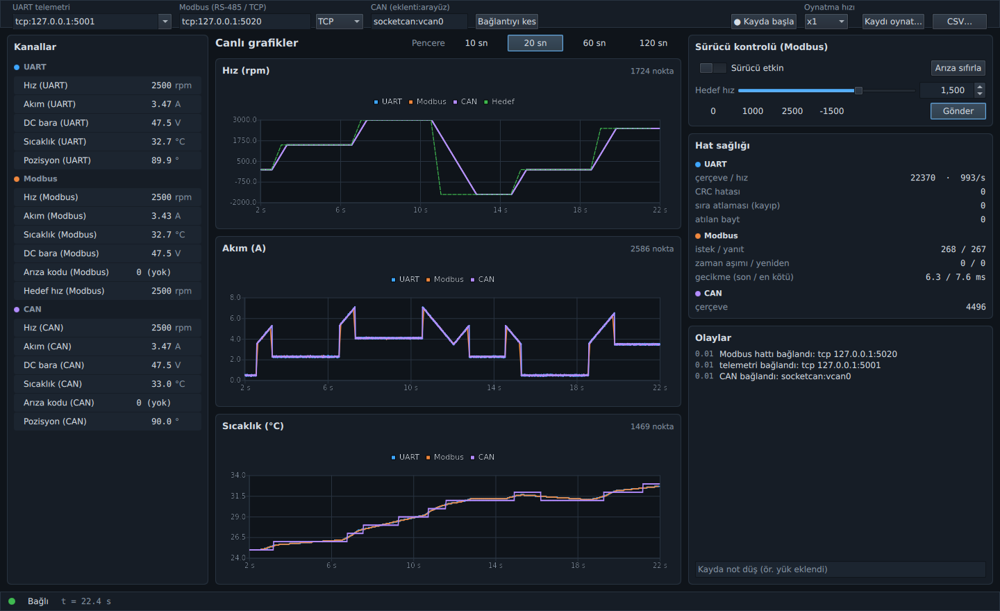
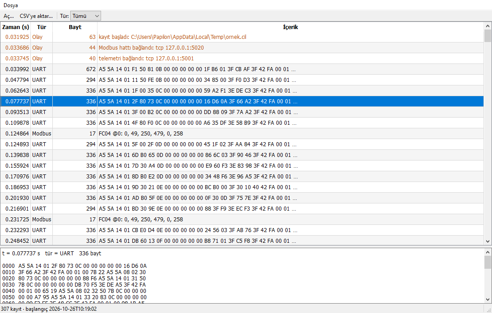

# cihaz-izleme-qt

[](https://github.com/l4NGEL/cihaz-izleme-qt/actions/workflows/ci.yml)

Bir motor sürücüsüyle UART, RS-485 (Modbus RTU), Modbus TCP ve CAN üzerinden konuşan,
gelen veriyi canlı çizen ve ham olarak kaydeden bir Qt 6 / QML masaüstü uygulaması.
C++17 ile yazıldı. Windows (MSVC) ve Linux (GCC) üzerinde derlenip test edildi.

Gerçek donanım olmadan denemek için depoda bir de cihaz benzeticisi var. Python ile
yazılmış bu benzetici, kurgusal **MSD-200** sürücüsünün üç arayüzünü taklit ediyor.



## Neler var

- **Hatlar**: seri port (`QSerialPort`), TCP ve UDP aynı `ByteTransport` arayüzünün
  arkasında duruyor. Bağlantı tek satırlık bir tanımla seçiliyor:
  `serial:COM3?baud=115200&parity=even`, `tcp:192.168.1.50:502`, `udp:14550`. TCP koparsa
  ya da USB-seri dönüştürücü çekilirse hat yeniden bağlanmayı deniyor (TCP için testli).
  Modbus RTU bu yüzden RS-485 yerine seri-ethernet dönüştürücü üzerinden TCP ile de
  konuşabiliyor.
- **UART telemetri**: 500 Hz ikili akış, `A5 5A | LEN | MSGID | SEQ | yük | CRC-16/CCITT`.
  Ayrıştırıcı bozuk bir çerçevede yalnızca bir bayt kaydırıp yeniden senkronlanıyor.
  Böylece bozuk çerçevenin içine düşen geçerli çerçeve kaybolmuyor. CRC hataları,
  atılan baytlar ve sıra numarası boşluklarından kestirilen kayıplar ayrı ayrı sayılıyor.
- **Modbus master**: RTU ve TCP (MBAP) çerçeveleme destekleniyor. Tek bir durum makinesi
  işi yürütüyor: yanıt beklenir, zaman aşımında yeniden denenir, istisna yanıtları ayrıca
  işaretlenir, RS-485 yön değişimi için kısa bir ara bırakılır. Periyodik sorgular kuyrukta
  birikmiyor. Kullanıcı yazmaları (hedef hız, kontrol sözcüğü) kuyruğun önüne alınıyor.
  İstek beklenmezken gelen baytlar "başıboş" sayılıp atılıyor.
- **CAN**: `QCanBus` eklentileri üzerinden çalışıyor (Linux'ta SocketCAN, Windows'ta
  PEAK vb.). Sinyaller DBC mantığıyla, Intel ve Motorola bayt sırasıyla çözülüyor.
  Hata çerçeveleri sayılıyor.
- **İş parçacıkları**: tüm hatlar, çözme ve kayıt ayrı bir edinim iş parçacığında
  çalışıyor. Arayüze örnek başına sinyal gitmiyor. Örnekler kilitli bir halka tampona
  yazılıyor, grafik onu kendi hızında (~30 Hz) okuyor. Sayaçlar ve olaylar 4 Hz'de
  kuyruklu sinyalle geliyor.
- **Grafik**: `QtCharts` kullanılıyor. Pencere, ekran genişliği kadar zaman kovasına
  bölünüp her kovanın min/max değeri çiziliyor. 30 saniyelik pencerede 15 000 nokta olsa
  bile tek örneklik bir akım tepesi grafikte görünür kalıyor.
- **Kayıt ve tekrar oynatma**: çözülmüş değerler değil, ham veri kaydediliyor (`.cil`):
  UART bayt parçaları gürültüleriyle birlikte, Modbus okuma blokları, CAN çerçeveleri ve
  olaylar. Oynatma canlı akışla aynı çözücüden geçiyor, yani sahada görülen bir CRC
  sorunu ofiste birebir yeniden üretilebiliyor. Program çökerse son kayıt yarım kalabilir;
  okuyucu bunu hata saymıyor, "yarım" olarak bildiriyor.
- **Kayıt görüntüleyici** (Qt Widgets): kayıtları tablo olarak gösteriyor
  (`QAbstractTableModel` + süzgeç vekili), seçilen kaydın hex dökümünü veriyor ve CSV'ye
  aktarıyor. Okuma ve dışa aktarma `QtConcurrent` ile arka planda çalışıyor, dışa aktarma
  iptal edilebiliyor.
- **cihaz-cli**: ekransız edinim, kayıt, oynatma ve CSV aracı. Arayüzle aynı
  `Acquisition` yolunu kullandığı için uçtan uca testleri de bu araç sürüyor.



## Mimari

```
                 ┌────────────────────── edinim iş parçacığı (DeviceSession) ─────────────────────┐
 UART  ─────────▶│ ByteTransport ─┐                                                               │
 RS-485/TCP ◀───▶│ ByteTransport ─┼▶ ModbusMaster (durum makinesi)                                │
 CAN   ─────────▶│ CanLink ───────┤                                                               │
                 │                ├─▶ logf::Writer  (.cil, ham veri)                               │
                 │                └─▶ StreamDecoder ─▶ Sample[] ──appendBatch──┐                   │
                 └──────────────────────────────────────┬──────────────────────┼───────────────────┘
                     statsUpdated (4 Hz), eventLogged    │ kuyruklu sinyal      ▼
                 ┌──────────────── arayüz iş parçacığı ──▼─────────┐   ┌─────────────────────────┐
                 │ Acquisition (ön yüz) ─▶ AppController (QML "App")│   │ SampleStore (kilitli    │
                 │ ChannelModel (10 Hz) ────────────── okur ───────┼──▶│ halka tampon, kanal     │
                 │ PlotFeeder (30 Hz, min/max seyreltme) ── okur ──┼──▶│ başına 120 000 nokta)   │
                 └──────────────────────────────────────────────────┘   └─────────────────────────┘
```

`Acquisition`, oturumu kendi `QThread`'ine taşıyor ve komutları kuyruklu çağrılarla
iletiyor. Soketler yaratıldıkları iş parçacığında kapatılmalı. Bu yüzden `stop()` önce
oturumu kendi iş parçacığında kapatıyor (`BlockingQueuedConnection`), sonra iş
parçacığının bitmesini bekliyor.

| Dizin | İçerik | Bağımlılık |
|---|---|---|
| `core/` | CRC'ler, UART çerçevesi, Modbus RTU/TCP, CAN sinyal çözme, cihaz haritası, `SampleStore`, kayıt dosyası, `StreamDecoder`, CSV | yalnız C++17 |
| `qt/` | `ByteTransport` + seri/TCP/UDP, `TransportFactory`, `CanLink`, `ModbusMaster`, `DeviceSession`, `Acquisition` | Qt Core, Network, SerialPort, SerialBus |
| `app/` | QML arayüz, `AppController`, `ChannelModel`, `EventLogModel`, `PlotFeeder` | Qt Quick, Quick Controls, Charts |
| `tools/` | `cihaz-cli`, `kayit-goruntuleyici` (Widgets) | Qt Widgets, Concurrent |
| `sim/` | `msd200_sim.py`: cihaz benzeticisi ve birim testleri | Python 3 standart kütüphane |

## Cihaz sözleşmesi (MSD-200)

**UART** (115200 8N1, 500 Hz)

| MSGID | Yük |
|---|---|
| `0x01` MotorStatus | u32 cihaz zamanı (µs), f32 hız (rpm), f32 akım (A), f32 bara gerilimi (V), i16 sıcaklık ×10, u16 durum |
| `0x02` Encoder | u32 cihaz zamanı, i32 enkoder sayımı (4096/tur) |
| `0x10` Event | ASCII metin (`FAULT OVERTEMP`, `ENABLED`…) |

**Modbus** (istasyon 1). Input register 0–5: hız, akım ×100, sıcaklık ×10, gerilim ×10,
arıza kodu, yazılım sürümü. Holding register 0: hedef hız (i16). Holding register 1:
kontrol sözcüğü (bit0 etkin, bit1 arıza sıfırla). Holding register 2: rampa (rpm/s).
Sınır dışı değerde istisna 03, olmayan adreste istisna 02 dönüyor.

**CAN** (11 bit)

| Kimlik | Bayt sırası | Sinyaller |
|---|---|---|
| `0x181`, 100 Hz | Intel | hız i16 (rpm), akım i16 ×0.01 A, gerilim u16 ×0.1 V, sıcaklık u8 −40 °C |
| `0x281`, 100 Hz | Motorola | arıza u8, durum u8, pozisyon u16 ×0.01° |
| `0x701`, 1 Hz | — | heartbeat |

## Derleme

**Linux** (Ubuntu 24.04, Qt 6.4). Docker imajı CI ile aynı paketleri kuruyor:

```bash
docker build -t cihaz-izleme-qt:dev .
docker run --rm --cap-add NET_ADMIN -v "$PWD:/src" cihaz-izleme-qt:dev scripts/docker-test.sh
```

`NET_ADMIN`, betiğin `vcan0` arayüzünü kurabilmesi için gerekiyor. Bu yetki verilmezse
yalnızca CAN senaryosu atlanıyor.

**Windows** (Visual Studio 2022 + Qt 6.8 MSVC). Betik derliyor, testleri koşturuyor ve
`windeployqt` ile çalışır halde bir dağıtım klasörü hazırlıyor (`build-win\dagitim`):

```bat
scripts\windows-derle.bat C:\Qt\6.8.3\msvc2022_64
```

Elle derlemek için CMake 3.22+ ve Qt 6.4+ (Core, Gui, Network, SerialPort, SerialBus,
Concurrent, Widgets, Qml, Quick, QuickControls2, Charts, Test) gerekiyor:
`cmake -S . -B build -DCMAKE_PREFIX_PATH=<qt>`.

## Çalıştırma

Benzeticiyi başlat. Windows'ta TCP uçları, Linux'ta istenirse `pty` kullanılabilir:

```bash
python sim/msd200_sim.py --uart tcp:5001 --modbus tcp:5020 --otomatik
python sim/msd200_sim.py --uart pty --modbus pty --can vcan0     # Linux: /dev/pts/N seri port gibi açılır
```

Arayüzün varsayılan tanımları bu TCP uçlarına bakıyor. `cihaz-izleme --baglan` doğrudan
bağlanıyor. Benzeticinin hata enjeksiyonu seçenekleri şunlar: `--hata-orani 0.0005`
(UART baytlarını bozar), `--mb-kayip 0.1` (Modbus yanıtlarının %10'unu düşürür),
`--yuk 6` (motoru aşırı ısınma arızasına sürer).

Ekransız kullanım:

```bash
cihaz-cli -t serial:/dev/ttyUSB0?baud=115200 -m serial:/dev/ttyUSB1?baud=19200 --sure 60 --kayit saha.cil
cihaz-cli -m tcp:192.168.1.50:502 --modbus-tcp --hedef 1500 --sure 5 --json
cihaz-cli --oynat saha.cil --hiz 10 --json
cihaz-cli --csv saha.cil --cikti saha.csv
```

## Testler

`ctest` 62 test koşturuyor. Linux'ta (Docker, Qt 6.4, GCC 13, `-Werror`) ve Windows'ta
(Qt 6.8.3, MSVC 19.44, `/W4 /WX`) hepsi geçiyor.

- **Çekirdek (GoogleTest, 56 test)**: CRC kontrol değerleri; bilinen Modbus çerçeveleri
  (`01 03 00 00 00 0A C5 CD` gibi); parça parça gelen yanıt; istisna ve yankı doğrulama.
  Rastgele tek bayt bozulmalarında yalnızca bozulan çerçevenin kaybolduğu, komşularının
  korunduğu ayrıca sınanıyor (2000 çerçeve, sabit tohum). CAN için Intel/Motorola
  yerleşimleri ve 2000 rastgele sinyal tanımında yaz-oku testi var. Min/max seyreltmenin
  tek örneklik tepeyi koruduğu, halka tamponda eşzamanlı yazma/okuma ve yarım kalmış kayıt
  dosyası da sınanıyor. Çekirdek CI'da TSan ve ASan/UBSan altında da koşuyor.
- **Qt (QtTest)**: taşıma tanımı ayrıştırma; TCP'nin kopup kendiliğinden yeniden
  bağlanması; UDP; Linux'ta `openpty` ile gerçek `QSerialPort` gidiş-dönüşü. Modbus master
  için zaman aşımı → yeniden deneme → başarısızlık, bozuk CRC sonrası toparlanma, yazmanın
  sorguların önüne geçmesi, periyodik sorgunun birikmemesi ve Modbus TCP işlem kimliği
  sınanıyor. `virtualcan` ile CAN gidiş-dönüşü var. Edinim iş parçacığı testi saniyede
  ~10 000 çerçeve basarken kayıpsız alımı ve arayüz iş parçacığındaki 5 ms'lik
  zamanlayıcının en kötü aralığını ölçüyor. Kayıt → x5 oynatma ve 10 kez art arda
  başlat/durdur da test ediliyor.
- **Uçtan uca** (`tests/e2e/e2e_test.py`): benzetici ile `cihaz-cli` ayrı süreçler olarak
  gerçek soket/pty üzerinden konuşuyor. Dört senaryo var:
  - TCP + Modbus TCP: hedef hız yazılır, kayıt alınır, x10 oynatılır ve CSV'ye aktarılır.
    Oynatma canlıyla aynı çerçeve sayısını vermek zorunda.
  - Hata enjeksiyonu: CRC hataları sayılır, akış sürer, kayıp Modbus yanıtları yeniden
    denemeyle kapanır.
  - pty üzerinden UART + Modbus RTU (8E1). Yalnız Linux.
  - `vcan0` üzerinden SocketCAN. Yalnız Linux.

Ölçülen değerler (bu makinede, benzeticiyle):

| | Linux (Docker) | Windows |
|---|---|---|
| Arayüz zamanlayıcısının en kötü aralığı, ~10 000 çerçeve/s yükte (hedef 5 ms) | 13 ms | 14 ms |
| Modbus TCP gecikmesi (son / en kötü) | 6.3 / 7.6 ms | 17 / 19 ms* |
| Temiz hatta CRC hatası / sıra atlaması | 0 / 0 | 0 / 0 |

\* Benzetici Python'da yazıldı ve yanıt öncesi kısa bir uyku yapıyor. Windows'ta
zamanlayıcı çözünürlüğü ~15 ms olduğu için bu fark benzeticiden geliyor, istemciden değil.

## Sınırlar

- Testlerin tamamı benzeticiyle ve sanal arayüzlerle (pty, `vcan0`, `virtualcan`) yapıldı.
  Gerçek bir RS-485 dönüştürücü, USB-CAN adaptörü ya da motor sürücüsüyle denenmedi.
- Windows'ta CAN için `QCanBus` eklentisi (ör. `peakcan`) kodda destekleniyor ama donanımla
  doğrulanmadı. Windows'ta otomatik testlerde yalnızca `virtualcan` kullanılıyor.
- Qt katmanı sanitizer altında koşmuyor; Qt kütüphaneleri TSan ile derlenmediği için
  sonuçlar yanıltıcı olurdu. TSan/ASan yalnız çekirdekte koşuyor.
- Arayüzdeki "Sürücü etkin" anahtarı gönderilen komutu gösteriyor, cihazdan okunan durumu
  değil. Cihazın gerçek durumu durum bayraklarından ve arıza kodundan izlenebiliyor.
- Bir UART okuma parçasındaki çerçeveler parçanın geliş zamanını alıyor (birkaç ms
  belirsizlik). Cihazın kendi µs zaman damgası yükte duruyor ama grafikte kullanılmıyor.

## Lisans

MIT
